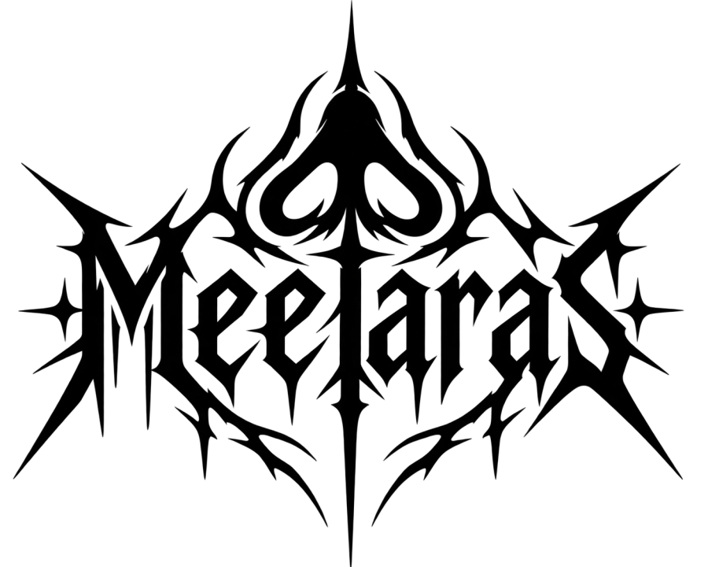
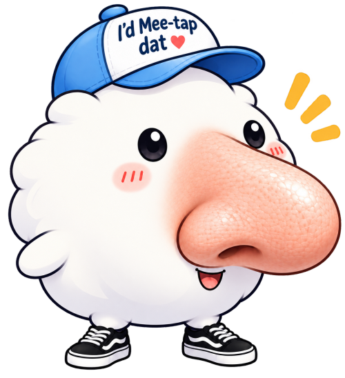

<h1 align="center">
  <picture>
    <source media="(prefers-color-scheme: dark)" srcset="docs/images/logo-white.png">
    
  </picture>
</h1>

<p align="center"><i>meet-AH-ras, Greek for "the one with the big nose".</i></p>



Turns a recorded talk into a video ready for YouTube. Give it the camera recording and the slides as a
PDF (optionally a screen recording, a separate mic, your intro/outro); one button later you have:

- **the video**, 1080p or 4K: the slide with the speaker in the corner, the speaker large where it
  matters, demos from the screen recording, name labels, intro/outro, levelled sound;
- **captions** (`.srt`), transcribed on your computer;
- **the YouTube text**: title options, description, tags and chapters.

The slides are recognised in the video, so the edit is drafted for you; fix anything in the editor and
only what changed is rendered again. Runs locally; only the YouTube text
[uses Claude](docs/guide.md#privacy-and-security). Or let an AI agent run the whole job for you.

## Recording a talk

A simple meetup setup is enough:

- **A phone on a tripod**, in landscape, that doesn't move during the talk. Frame the speaker together
  with the projected slides behind them: Meetaras finds the slide changes by recognising the slides in
  the picture. On an iPhone, *Most Compatible* with *HDR Video* off converts fastest
  ([Faster input](docs/guide.md#faster-input)).
- **The slides as a PDF** from the speaker (Keynote, PowerPoint and Google Slides all export one).
- **Ideally, a screen recording of the speaker's laptop** for the whole talk (QuickTime Player on a Mac:
  File → New Screen Recording). The slide changes are then exact, and demos, code and terminals are
  shown from it, sharp, instead of filmed off the wall.
- Optionally a **separate microphone recording**, if the phone is far from the speaker; it is
  lined up with the video automatically.

## Install

You need [uv](https://docs.astral.sh/uv/), ffmpeg (with zscale, for iPhone HDR video) and git.

**macOS**, with [Homebrew](https://brew.sh):

```sh
xcode-select --install            # Apple's command line tools: git, and the compiler for captions (if not installed yet)
brew install uv ffmpeg-full
echo 'export PATH="$(brew --prefix ffmpeg-full)/bin:$PATH"' >> ~/.zprofile && source ~/.zprofile
git clone https://github.com/polaralex/meetaras.git && cd meetaras && uv sync
uv run meetaras                   # opens the app at http://127.0.0.1:8765
```

Homebrew's plain `ffmpeg` lacks zscale; `ffmpeg-full` has it but isn't put on your PATH by itself, hence
the `echo` line (once).

**Linux** (Debian, Ubuntu; elsewhere install your distribution's ffmpeg, which needs zscale):

```sh
sudo apt install ffmpeg git
curl -LsSf https://astral.sh/uv/install.sh | sh
git clone https://github.com/polaralex/meetaras.git && cd meetaras && uv sync
uv run meetaras                   # opens the app at http://127.0.0.1:8765
```

The first time, open **Setup** on the home page: it checks every tool and sets up captions with one click.

## Quick start

1. **New talk**: choose the camera video and the slides PDF (plus the optional files) and fill in the
   talk title, speaker, event and date.
2. **Make video**: converts, drafts the edit, transcribes, writes the YouTube text and exports, in the
   background.
3. **Review and fix** in the editor if you like (press **Help** there), then **Make video** again.
4. **Upload** the video and its `.srt` from the talk's `output/` folder, and paste the text from
   **YouTube**.

## Or let an AI agent do it

Meetaras comes with a [skill](.claude/skills/talk-video/SKILL.md) for
[Claude Code](https://claude.com/claude-code): start `claude` in the meetaras folder and hand it the files.

```
> Make a video of my talk: camera ~/Downloads/IMG_4211.MOV, slides ~/Downloads/deck.pdf,
  screen recording ~/Downloads/screen.mov. Podos Podaras, DevOps Thessaloniki, Oct 14.
```

Claude drives the whole process, and edits the video itself when you ask ("cut the Q&A", "the demo at
40:00 full screen"). You can still open the editor at any point to check and improve things yourself.

## More

- [Using Meetaras](docs/guide.md): the steps in detail, editor keys, captions on a Mac, 4K, the
  output, privacy and security.
- [Command line and timeline file](docs/reference.md): every step as a command, and the `timeline.txt`
  format the app writes.
- [Contributing](CONTRIBUTING.md): tests and working on the code.

## License

Apache-2.0 (see [LICENSE](LICENSE)); keep the [NOTICE](NOTICE) file with any copy or fork. The Meetaras name,
logos and mascot are not covered by the license: a fork needs its own name and branding. Bundled Noto Sans:
SIL Open Font License. Meetaras uses PyMuPDF, which is AGPL-3.0 (or commercially licensed by Artifex).
